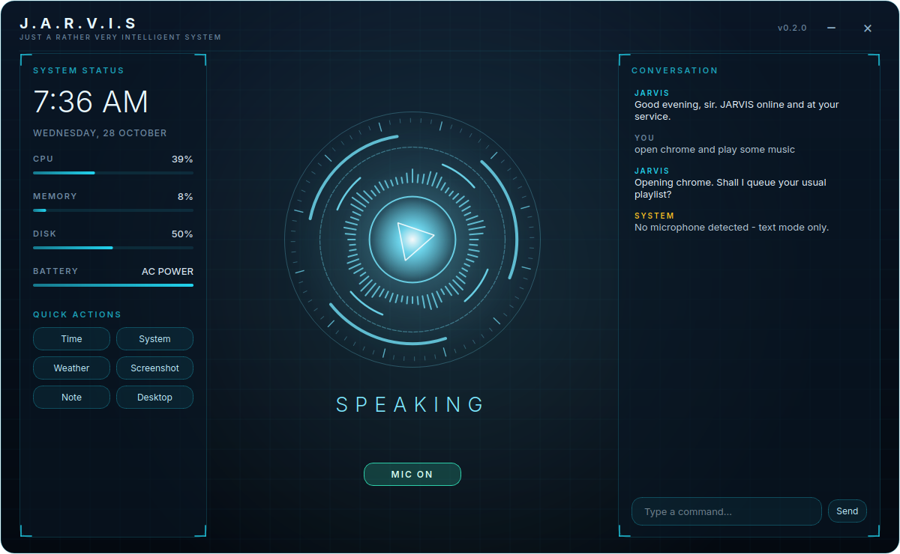

# 🤖 JARVIS — Free Voice AI Assistant for Windows



A free, open-source, JARVIS-style desktop assistant for Windows. Talk to your PC, let it open apps, search the web, control volume, take notes, and chat using a **local, private AI** — no paid APIs required.


## ✨ Features

| Category | What it can do |
|---|---|
| 🖥️ HUD interface | Animated arc-reactor core that reacts to Standby / Listening / Processing / Speaking, live system stats, chat log, quick-action buttons, set in the [Inter](https://rsms.me/inter/) typeface |
| 🎙️ Voice | Wake word "Jarvis", free speech recognition, offline text-to-speech |
| 🧠 AI brain | Local LLM via [Ollama](https://ollama.com) (offline, private) with short-term memory |
| 💻 PC control | Open/close apps, folders & websites, volume, screenshots, lock, shutdown/restart (with confirmation) |
| 🔎 Web | Google search, "play X on YouTube", weather (no API key) |
| 📝 Productivity | Voice notes, typing text, system status (CPU / RAM / battery), time & date |
| ⌨️ Text mode | `--text` flag to use without a microphone |

## 🚀 Quick Start

### 1. Prerequisites
- Windows 10/11
- [Python 3.10+](https://www.python.org/downloads/) (tick **Add to PATH**)
- [Ollama](https://ollama.com/download) (for the AI brain)

### 2. Install
```bash
git clone https://github.com/<your-username>/jarvis.git
cd jarvis
pip install -r requirements.txt
ollama pull llama3.2:3b
```
> If PyAudio fails: `pip install pipwin` then `pipwin install pyaudio`.

### 3. Run
```bash
python main.py            # opens the HUD — say "Jarvis, ..." or click the core to talk
python main.py --no-mic   # start with the mic off (type in the chat box)
```
Or just double-click **`run_jarvis.bat`**. To build a standalone `.exe`, run **`build_exe.bat`**.

**Using the HUD:** click the glowing core for push-to-talk, toggle **MIC** for always-listening wake-word mode, or type commands in the chat box.

## 🗣️ Example Commands

```
Jarvis, open chrome
Jarvis, open downloads
Jarvis, close notepad
Jarvis, play Arijit Singh on YouTube
Jarvis, search for best python tutorials
Jarvis, what's the weather in Mohali
Jarvis, volume up / mute
Jarvis, take a screenshot
Jarvis, take a note buy milk tomorrow
Jarvis, how is my system doing
Jarvis, lock my pc
Jarvis, restart the computer        (asks to confirm)
Jarvis, tell me a joke              (handled by the AI brain)
Jarvis, goodbye
```

## ⚙️ Configuration

Set environment variables (see `.env.example`) or edit `jarvis/config.py`:

| Variable | Default | Purpose |
|---|---|---|
| `JARVIS_MODEL` | `llama3.2:3b` | Ollama model to use |
| `JARVIS_LANG` | `en-IN` | Speech recognition language (`en-US`, `hi-IN`, …) |
| `JARVIS_TITLE` | `sir` | How JARVIS addresses you |
| `OLLAMA_URL` | `http://localhost:11434/api/chat` | Ollama endpoint |

## 🧩 Adding Your Own Skill

Skills are small functions registered in the `SKILLS` list in `jarvis/skills.py`:

```python
def sk_hello(t, ctx):
    return "Hello there!"

SKILLS.append((r"^say hello", sk_hello))
```
First matching regex wins; anything unmatched goes to the AI brain.

## 📁 Project Structure
```
main.py                 entry point
jarvis/
  assistant.py          background worker (listen → think → act → speak)
  skills.py             PC-automation commands
  brain.py              Ollama LLM client
  voice.py              speech recognition + text-to-speech
  config.py             settings, app/site/folder maps
  ui/                   HUD: window, animated core, widgets, theme, fonts
  assets/fonts/         bundled Inter (SIL OFL licence included)
```

## 🗺️ Roadmap
See [docs/ROADMAP.md](docs/ROADMAP.md). Next up: wake-word engine, offline speech recognition, AI tool-calling, HUD interface.

## 🔒 Privacy & Safety
- The AI runs locally through Ollama; chat text never leaves your PC.
- Speech recognition currently uses Google's free web API (audio is sent to Google) until offline recognition lands in Phase 2.
- Shutdown/restart require voice confirmation and can be cancelled.

## 🛠️ Troubleshooting
| Problem | Fix |
|---|---|
| "My brain isn't online" | Start Ollama and run `ollama pull llama3.2:3b` |
| Window won't open | Run `pip install -r requirements.txt` again; use Python 3.10–3.12 |
| Mic not detected | Check Windows Settings → Privacy → Microphone |
| Misheard commands | Speak closer to the mic, or set `JARVIS_LANG` to your accent |
| `PyAudio` install error | Use the `pipwin` method above |

## 🤝 Contributing
See [CONTRIBUTING.md](CONTRIBUTING.md). PRs welcome!

## 📄 License
[MIT](LICENSE)

## 🙏 Credits
[Inter](https://github.com/rsms/inter) typeface © The Inter Project Authors, SIL Open Font License 1.1.
